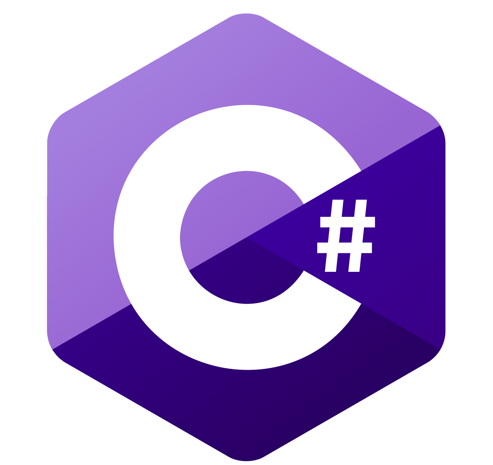

Argentinian (🇦🇷) <b>Backend</b> & <b>Distributed systems</b> developer with <b>Frontend knowledge</b> trying to be an OS Dev.
  
<em>- "Only a slave quantifies its existence through productivity".</em>

 
  <picture>
    
  </picture>

I speak these languages:

  <ul>
    <li><b> Spanish (native).</b></li>
    <li><b> English (B2).</b></li>
</ul>

  
 

  
  

 

  <h2 align="center" color="white">
    Main Languages
  </h2>

  

  &nbsp;
  <code></code>
  &nbsp;&nbsp;
  <code></code>
  &nbsp;&nbsp;
 <code></code>
  &nbsp;&nbsp;
 <code></code>
  &nbsp;
  

<section>
<h4 align="left">Planned to learn in a future:</h4>
<ul>
    <li>Assembly</li>
</ul>
</section>
